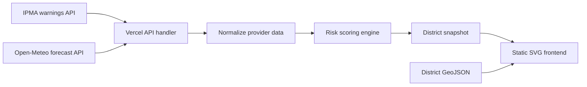

# Stormgauge

Stormgauge is a live storm-risk map for mainland Portugal. It combines official
weather warnings from IPMA with short-term wind and precipitation data from
Open-Meteo, then presents the result by district in a focused, interactive map.

The public demo is available at [storm-risk-map.vercel.app](https://storm-risk-map.vercel.app).

## What the application does

The frontend polls the live API every three seconds. Each of Portugal's 18
mainland districts is rendered as a real GeoJSON boundary and receives a
0-100 risk score based on:

- IPMA warning level and warning type;
- maximum forecast wind gust;
- maximum hourly precipitation;
- accumulated precipitation over 24 hours.

Selecting a district opens a technical panel with the calculated risk factors,
weather values, active IPMA warnings, warning severity, and each warning's
validity window. The map supports animated district zoom, a reset control, and
right-button drag navigation. The interface is responsive and works on desktop
and mobile screens.

This is an experimental indicator for exploration and software development. It
does not replace official IPMA or Civil Protection warnings.

## Architecture



### Runtime flow

1. `api/index.ts` receives a request for `/api/risk`.
2. IPMA warnings and Open-Meteo forecasts are fetched concurrently.
3. Provider adapters normalize external responses into the internal domain
   types.
4. `src/risk/score.ts` calculates the factors, score, level, and contributing
   warnings for every district.
5. The API returns one complete snapshot.
6. `public/app.js` keeps the last valid map and polls for the next snapshot
   every three seconds.

The local server uses the same providers and scoring engine, but keeps the
latest snapshot in memory and also exposes an optional Server-Sent Events
endpoint. The Vercel deployment uses the serverless handler in `api/index.ts`
and serves the static frontend from `public/`.

## Project structure

```text
storm-risk-map/
├── api/
│   └── index.ts                    # Vercel serverless API
├── public/
│   ├── index.html                  # UI, layout and responsive styles
│   ├── app.js                      # SVG map, interaction and polling
│   └── data/
│       └── portugal-districts-simplified.geojson
├── src/
│   ├── config.ts                   # Environment configuration
│   ├── data/regions.ts             # The 18 mainland districts
│   ├── providers/
│   │   ├── ipma.ts                 # IPMA warning adapter
│   │   ├── openmeteo.ts            # Open-Meteo forecast adapter
│   │   ├── live.ts                 # Live provider composition
│   │   └── mock.ts                 # Offline demo provider
│   ├── risk/score.ts               # Pure risk calculation
│   ├── scheduler.ts                # Local polling and retries
│   ├── store.ts                    # In-memory snapshot store
│   ├── server.ts                   # Local HTTP server and API
│   └── types.ts                    # Shared domain contracts
├── test/
│   └── score.test.ts               # Risk and provider tests
├── vercel.json                     # Vercel build configuration
└── package.json
```

## Risk model

The score is intentionally explainable rather than opaque:

```text
warning = strongest weighted IPMA warning + simultaneous-warning bonus
wind    = curve(maximum forecast gust)
rain    = max(hourly precipitation curve, 24-hour precipitation curve)
score   = max(0.45 * warning + 0.30 * wind + 0.25 * rain,
              0.80 * warning)
```

The resulting levels are:

| Score | Level |
| ---: | --- |
| 0-24 | Low |
| 25-49 | Moderate |
| 50-74 | High |
| 75-100 | Extreme |

The thresholds and curves are MVP heuristics. They should be calibrated against
historical events before the score is used for operational decisions.

## API

| Endpoint | Description |
| --- | --- |
| `GET /api/health` | Service and provider status |
| `GET /api/risk` | Complete live risk snapshot |
| `GET /api/risk.geojson` | Snapshot as a GeoJSON feature collection |
| `GET /api/stream` | Local Server-Sent Events stream |

The API can optionally require a key. Set `API_KEYS=key-one,key-two` and send
the key through the `x-api-key` header or the `?key=` query parameter.

Example response:

```json
{
  "generatedAt": "2026-11-10T11:34:02Z",
  "mode": "live",
  "regions": [
    {
      "id": "VCT",
      "name": "Viana do Castelo",
      "score": 91,
      "level": "extreme",
      "factors": {
        "warning": 95,
        "wind": 90,
        "rain": 84
      },
      "gustKmh": 120,
      "precipMmH": 17.2,
      "precip24hMm": 96.4,
      "warnings": [
        {
          "type": "Wind",
          "level": "red",
          "start": "2026-11-10T12:00:00Z",
          "end": "2026-11-10T21:00:00Z"
        }
      ]
    }
  ]
}
```

## Local development

Requirements:

- Node.js 22 or newer;
- network access for live IPMA and Open-Meteo data.

```bash
npm install
npm run dev
```

The local application is available at `http://localhost:3000`.

For an offline deterministic demo:

```bash
npm run dev:mock
```

On Windows PowerShell, use this equivalent command if the package script's
Unix-style environment assignment is not supported:

```powershell
$env:DATA_MODE = "mock"
npm run dev
```

Useful checks:

```bash
npm test
npm run typecheck
npm run build
```

Environment variables are documented in `.env.example`. The most relevant
options are `PORT`, `DATA_MODE`, `STORM_NAME`, `API_KEYS`, and `CORS_ORIGIN`.

## Deployment

The project is deployed on Vercel with two parts:

- `@vercel/node` builds `api/index.ts` as the live API;
- `@vercel/static` serves the files under `public/`.

Deploy with:

```bash
npx vercel
npx vercel --prod
```

Configure `STORM_NAME`, `API_KEYS`, and `CORS_ORIGIN` in the Vercel project
settings when needed. The frontend does not contain provider credentials.

## Limitations

- The current map covers mainland Portugal only; the Azores and Madeira are
  outside the present scope.
- The risk score is an explainable heuristic, not an official forecast.
- Weather data depends on the availability and terms of IPMA and Open-Meteo.
- The district geometry is simplified for a lightweight browser experience.

## License and data sources

The application code is maintained in this repository. IPMA warnings and
Open-Meteo forecast data remain subject to their respective terms, attribution
requirements, and usage limits.
